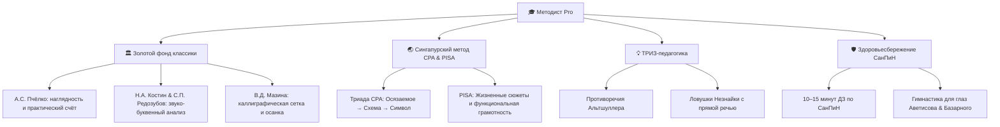

# 🦉 Методист Pro
### Умная цифровая экосистема педагога начальной школы, воспитателя и завуча
*Мировые стандарты образования и золотой фонд отечественной педагогики — в каждом уроке за 2 минуты.*

---

## 🌟 Наша миссия и философия

> **«Каждый ребёнок — от столичной гимназии до малокомплектной сельской школы — заслуживает вдохновляющего, глубокого и современного образования.»**

Работа школьного учителя — это великое призвание, которое слишком часто заглушается рутиной: бесконечными часами составления поурочных планов, оформлением рабочих листов, поиском дифференцированных заданий и оформлением отчётов.

**«Методист Pro»** создан для того, чтобы:
1. **Вернуть учителю радость живого общения с детьми.** Экосистема берёт на себя 90% рутинной подготовки: за 120 секунд вы получаете развёрнутый сценарий урока на 2500+ слов, полиграфический рабочий лист с готовыми ответами и домашнее задание.
2. **Дать сельской и районной школе ресурсы лучших лицеев мира.** Даже если в классе нет проектора и скоростного интернета, система формирует чёткие схемы меловой доски, эксперименты на доступных природных материалах и экономичную печать 2-в-1.
3. **Опереться на золотой фонд педагогики.** Мы не генерируем шаблонные сухие конспекты — каждый материал строится на проверенных принципах советской классики, сингапурского метода наглядного моделирования и ТРИЗ-педагогики.

---

## 🏛️ Педагогический фундамент: Синтез классики и мировых методик

Каждый урок в **«Методист Pro»** проектируется по строгим законам классической методики преподавания, усиленным передовыми мировыми практиками:

### 1. Золотой фонд отечественной педагогики
- **А.С. Пчёлко (Арифметика):** Принцип глубокой предметной наглядности. Никаких абстрактных вычислений в отрыве от жизни — каждое математическое действие объясняется через пересчёт реальных предметов (палочки, шишки, яблоки, монеты).
- **Н.А. Костин и С.П. Редозубов (Русский язык и Чтение):** Осмысленное слоговое чтение, развитие тонкого фонематического слуха, орфографическая зоркость и словарно-логические упражнения.
- **В.Д. Мазина и Н.Н. Боголюбов (Каллиграфия):** Формирование правильного динамического стереотипа письма, ритмический такт и тетрадная разметка, предотвращающая спазм детской кисти.

### 2. Сингапурский подход CPA (Concrete $\rightarrow$ Pictorial $\rightarrow$ Abstract)
- **Concrete (Осязаемый предмет):** Ребёнок исследует физические объекты (кубики, счётные палочки, природные материалы).
- **Pictorial (Схема / Модель-брусок Bar Model):** Перевод осязаемого опыта в наглядный рисунок, схему или пропорциональный блок.
- **Abstract (Символ и формула):** Запись математического выражения или грамматического правила только тогда, когда смысл полностью понятен и пережит ребёнком.

### 3. Функциональная грамотность PISA и TIMSS
- Умение применять знания в реальной жизни: расчёт сдачи в магазине, чтение расписания школьного автобуса, приготовление семейного рецепта, измерение клумбы для рассады цветов.

### 4. ТРИЗ-педагогика Г.С. Альтшуллера
- **Поиск противоречий:** «Как передать весточку другу, если нет бумаги и телефона?», «Как измерить объём камня неправильной формы без линейки?».
- **Ловушки мышления (Ловушка Незнайки):** Незнайка высказывает типичное детское заблуждение, а класс в роли добрых исследователей находит ошибку и формулирует нерушимое правило.

---

## 🚀 Ключевые возможности системы

### 🎭 1. Живая драматургия урока (2000–3000+ слов)
- **Дословный сценарий диалога:** Подробные реплики учителя (*«Учитель: "..."»*) и прогнозируемые многоголосые ответы детей (*«Дети: "..."»*). Молодой педагог или родитель чувствует себя уверенно у доски с первой секунды.
- **Поминутный тайминг этапов:** Строгий регламент 40-минутного урока — Введение (3–5 мин), Актуализация (5–7 мин), Открытие нового (10–12 мин), Физминутка (2–3 мин), Закрепление (10 мин), Рефлексия (3–5 мин).
- **Сюжетные дидактические игры:** Интрига с первых секунд, соревновательный дух в микрогруппах и смысловая рефлексия.

---

### 💻 2. Интерактивный пульт ведения урока (Presenter Mode)
Удобный полноэкранный режим для ведения урока с интерактивной панели, проектора, ноутбука или планшета:
- ⏱️ **Умный таймер этапов:** Крупный таймер с цветовой шкалой, предупреждающий о завершении этапа за 60 секунд.
- 🔔 **Колокольчик тишины (`Клавиша B` / Экранный колокольчик):** Мягкий гармоничный сигнал колокольчика для мгновенного привлечения внимания класса без повышения учительского голоса.
- 👥 **Ротация ролей в парах (`Клавиша S` / Таймер):** Звуковой сигнал гонга и автоматическая смена ролей каждые 7–10 минут:
  - 🧭 **Штурман** — ведёт по заданию и объясняет алгоритм;
  - ✍️ **Летописец** — аккуратно записывает решение в чистовик;
  - 🟢 **Контролёр** — проверяет зелёным карандашом каждую букву и запятую;
  - 📢 **Спикер** — представляет результат перед всем классом.

---

### 🎙️ 3. Аудио-Студия & Диктант [PRO]
Полноценный речевой центр поддержки педагога на базе качественного голосового синтеза:
- 📢 **Голосовая заметка родителю:** Мгновенная озвучка и генерация персонального аудио-отчёта или сообщения для родительского чата WhatsApp/Telegram с тёплым напутствием, описанием успеха ребёнка и акцентами для домашнего повторения.
- 🎧 **Орфографический 3-этапный диктант:**
  1. *Первичное целостное прослушивание* текста в естественном темпе с разбором непонятных старинных слов;
  2. *Пошаговая диктовка по смысловым синтагмам* с автоматическими 10-секундными паузами для чистописания;
  3. *Контрольная самопроверка* в медленном размеренном темпе со звуковым сигналом карандаша.

---

### 🌾 4. Сельская школа & Технология Zero-Paper
Специальный режим для школ с дефицитом оборудования и бумаги:
- 🏛️ **3-створчатая меловая доска:** Детальный план оформления обычной меловой доски (Левая створка — домашняя работа и опора; Центральная — тема, образные схемы и алгоритмы; Правая — задания для самостоятельной работы и рефлексия).
- 🖨️ **Эко-печать 2-в-1:** Интеллектуальная верстка двух полноценных рабочих листов на одну страницу А4 для двукратной экономии бумаги и картриджа принтера.
- 🧪 **Low-Tech Kitchen Lab:** Лабораторные практикумы на подручных материалах. Опыты с сосновыми шишками, фасолью, пуговицами, крупой, каплями воды, бумажными корабликами — наука доступна каждому классу без закупки дорогостоящих наборов.
- 🤝 **Бережная инклюзия ОВЗ / ЗПР:** Специальные карточки-помощницы и адаптированный визуальный ряд без стигматизации, позволяющий детям с особыми потребностями комфортно работать в общем строю.

---

### 🛡️ 5. Здоровьесбережение по СанПиН
- **Строгий лимит домашнего задания:** Объем заданий строго откалиброван — не более 10–15 минут для 1–2 классов и до 20–25 минут для 3–4 классов.
- **Офтальмологическая разминка:** Комплексы упражнений для снятия спазма аккомодации глаз по профессорам Э.С. Аветисову и В.Ф. Базарному (восьмёрки, круги, метка на окне).
- **Двигательные и дыхательные паузы:** Весёлые тематические четверостишия с координацией движений.

---

### 📄 6. Полиграфические раздатки музейного качества
- 📐 **Векторная сетка 5×5 мм и косая линия:** Идеальная клетка, согласованная со стандартами тетрадей А.С. Пчёлко.
- ✂️ **Отрезные карточки-помощницы:** Карточка с подсказкой и пошаговым алгоритмом легко отрезается ножницами для ученика, которому нужна дополнительная опора.
- 🎯 **3 дифференцированных уровня сложности:**
  - 🟢 **«Старт»** — базовое закрепление по образцу;
  - 🟡 **«Практик»** — самостоятельное применение в нестандартной ситуации;
  - 🔴 **«Детектив Pro»** — эвристические и олимпиадные задачи на сообразительность.
- 🔑 **Готовый лист ответов с ключами:** Экономит учителю время проверки стопки тетрадей — все ответы и критерии сведены в компактный блок.
- 🎨 **Иллюстрации YandexART:** Панорамные обложки и аккуратные контурные раскраски, развивающие мелкую моторику руки.

---

### 🌌 7. Пять игровых миров со сквозным сюжетом
Ученики начальной школы учатся через игру. В приложении создано 5 тематических игровых миров:

| Игровой мир | Маскот-проводник | Смысловая направленность |
|---|---|---|
| 🌲 **Волшебный Лес** | 🦉 Совёнок Архимед | Окружающий мир, природная гармония, доброта и дружба |
| 🚀 **Космическая Академия** | 🤖 Робот Квантик | Астрономия, логика, алгоритмы, будущее и изобретения |
| 🌊 **Подводное Царство** | 🐬 Дельфинёнок Немо | Глубины океана, экология, тайны глубин и командная взаимовыручка |
| 🏰 **Царство Математики** | 🦊 Лисёнок Пифагор | Счёт, геометрические фигуры, логические лабиринты и шифры |
| ⚙️ **Город Мастеров** | 🦫 Бобрёнок Винтик | Ремесла, чертежи, прикладные навыки, физика и моделирование |

---

### 📱 8. Обучающие Истории (Stories) в стиле Mobbin
12 интерактивных анимированных обучающих историй (более 28 слайдов):
- Плавные пружинные переходы между слайдами;
- Пульсирующий живой маскот с мягким неоновым свечением;
- Стеклянные полупрозрачные плашки заголовков;
- Приятный тактический виброотклик на смартфонах;
- Пошаговое руководство по каждому инструменту прямо на ладони.

---

## 🏛️ Тарифы и возможности экосистемы

| Возможность | Старт (Free) | Методист PRO | 👑 Директор (Кафедра) |
|---|:---:|:---:|:---:|
| **Глубокие сценарии уроков** | Базовый объём | 2000–3000+ слов с дословной речью | 2000–3000+ слов с дословной речью |
| **Педагогический фундамент** | ФГОС Базовый | Сингапур (CPA) + ТРИЗ + Пчёлко + Мазина | Полный комплекс + свои методики |
| **Сельская школа & Zero-Paper** | — | ✅ Меловая доска, 2-в-1, Kitchen Lab | ✅ Меловая доска, 2-в-1, Kitchen Lab |
| **Интерактивный пульт (Presenter)** | Базовый таймер | ✅ Колокольчик `B`, смена ролей `S` | ✅ Колокольчик `B`, смена ролей `S` |
| **Аудио-Студия & Диктант** | — | ✅ Голос родителям, 3-этапный диктант | ✅ Голос родителям, 3-этапный диктант |
| **Полиграфические материалы** | Базовый лист | ✅ Векторная сетка 5х5мм, карточки ✂, ключи | ✅ Векторная сетка 5х5мм, карточки ✂, ключи |
| **Нейроиллюстрации YandexART** | — | ✅ 4K панорамы и раскраски | ✅ 4K панорамы и раскраски |
| **Экспорт материалов** | PDF | PDF, Word (.docx), PowerPoint (.pptx) | PDF, Word, PowerPoint, ZIP-архивы |
| **Пакетный генератор четверти** | — | — | 👑 **15–30 уроков в 1 клик с единым ZIP** |
| **Конструктор школьных миров** | — | — | 👑 **Свой маскот, логотип школы и стилистика** |
| **Интеграция с ЭЖД / Сферум** | — | — | 👑 **Экспорт в МЭШ, ЭЖД, Сферум, Moodle** |
| **Командный доступ кафедры** | 1 пользователь | 1 пользователь | 👑 **3–5 рабочих мест педагогов школы** |

---

## 🤖 Экосистема Telegram & Мобильность

- 📱 **Telegram Mini App (TMA):** Конструктор открывается прямо внутри Telegram на смартфонах iOS и Android — быстро, плавно, с поддержкой жестов и виброотклика.
- 🦉 **Персональный бот-помощник (@annmetodist_bot):** Доступ к умному помощнику, генерации викторин, экспресс-тестов и памяток родителям прямо в диалоге.
- ⚡ **Бот кафедры (@MetodistAIpro_bot):** Корпоративный ассистент для планирования заседаний методических объединений и подготовки открытых уроков.

---

## 💡 Будущее образования строится сегодня

**«Методист Pro»** объединяет уважение к труду учителя, научную строгость и современные цифровые возможности. 

Каждый урок становится маленьким праздником открытия мира, в котором дети горят желанием учиться, а педагог уверен в каждом своём слове и действии.

---
*С любовью к детям и бесконечным уважением к благородному труду Учителя.*
