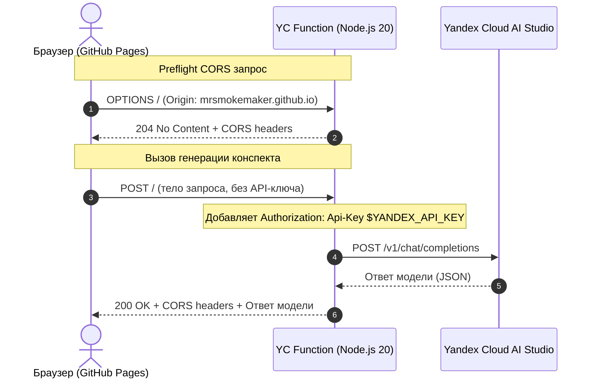

# Безопасный вызов YandexGPT через Cloud Functions (CORS Proxy)

Веб-приложение **«Методист»** хостится на GitHub Pages (`https://mrsmokemaker.github.io`). Напрямую из браузера обращаться к `https://ai.api.cloud.yandex.net/v1/chat/completions` нельзя из-за браузерной политики CORS (Cross-Origin Resource Sharing) и риска компрометации API-ключа.

Для решения проблемы используется серверный прокси на **Yandex Cloud Functions (Node.js 20)**.

---

## 1. Архитектура решения



---

## 2. Пошаговая настройка в Яндекс Облаке

### Шаг 1. Создание сервисного аккаунта и назначение роли

1. Откройте [Консоль управления Yandex Cloud](https://console.cloud.yandex.ru/).
2. Перейдите в ваш каталог и откройте раздел **Сервисные аккаунты**.
3. Нажмите **Создать сервисный аккаунт**:
   - Имя: `metodist-gpt-invoker`
   - Роль: `ai.languageModels.user` (необходима для генерации через YandexGPT / Foundation Models).
4. Нажмите **Создать**.

### Шаг 2. Создание API-ключа сервисного аккаунта

1. Нажмите на созданный сервисный аккаунт `metodist-gpt-invoker`.
2. На панели сверху нажмите **Создать новый ключ** → **Создать API-ключ**.
3. Скопируйте значение секретного ключа (он показывается только один раз).
   > **Важно**: Никогда не коммитьте этот ключ в репозиторий! Он будет храниться исключительно в защищённых переменных окружения Cloud Function.

### Шаг 3. Создание функции в Yandex Cloud

Через консоль или CLI создайте функцию:

```bash
yc serverless function create --name yandex-gpt-proxy
```

Сделайте функцию публичной (чтобы фронтенд из браузера мог к ней обращаться без авторизации IAM):

```bash
yc serverless function allow-unauthenticated-invoke yandex-gpt-proxy
```

### Шаг 4. Деплой версии функции

Выполните команду из корня проекта:

```bash
yc serverless function version create \
    --function-name yandex-gpt-proxy \
    --runtime nodejs20 \
    --entrypoint index.handler \
    --memory 128Mi \
    --execution-timeout 35s \
    --environment YANDEX_API_KEY="<ВАШ_API_КЛЮЧ>" \
    --environment YANDEX_FOLDER_ID="<ВАШ_FOLDER_ID>" \
    --source-path ./yandex_gpt_proxy
```

> **Примечание**: Параметр `YANDEX_FOLDER_ID` опционален, но рекомендуется указать идентификатор вашего каталога Яндекс Облака, чтобы прокси автоматически формировал корректный путь модели `gpt://<FOLDER_ID>/yandexgpt-lite`.

После деплоя в выводе консоли или в интерфейсе Яндекс Облака скопируйте **URL для вызова функции** (например: `https://functions.yandexcloud.net/d4e...`).

---

## 3. Настройка клиентского приложения

1. Откройте веб-приложение «Методист» в браузере.
2. Перейдите в раздел **Настройки**.
3. В поле **URL прокси-функции** вставьте скопированный URL (например, `https://functions.yandexcloud.net/d4e...`).
4. Нажмите **Проверить связь**:
   - Приложение отправит тестовый пинг через прокси.
   - Появится зелёный статус: *«Соединение с YandexGPT через прокси успешно установлено!»*
5. Нажмите **Сохранить** (URL сохранится в защищённом локальном хранилище браузера).
6. Перейдите в раздел **Новый конспект** и запустите генерацию.

---

## 4. Чек-лист проверки работы

- [x] **1. Preflight OPTIONS возвращает 204 и CORS-заголовки**:
  ```bash
  curl -i -X OPTIONS https://<URL_ФУНКЦИИ> \
    -H "Origin: https://mrsmokemaker.github.io" \
    -H "Access-Control-Request-Method: POST"
  ```
  *Ожидаемый ответ*: HTTP `204 No Content`, присутствуют заголовки:
  - `Access-Control-Allow-Origin: https://mrsmokemaker.github.io`
  - `Access-Control-Allow-Methods: POST, OPTIONS`
  - `Access-Control-Allow-Headers: Content-Type, Authorization, x-folder-id`

- [x] **2. POST без ключа на сервере возвращает 401**:
  Если переменная `YANDEX_API_KEY` в функции не задана, прокси возвращает `401 Unauthorized` с понятным текстом ошибки.

- [x] **3. POST с корректным телом возвращает ответ модели (200 OK)**:
  ```bash
  curl -i -X POST https://<URL_ФУНКЦИИ> \
    -H "Content-Type: application/json" \
    -H "Origin: https://mrsmokemaker.github.io" \
    -d '{"messages":[{"role":"user","content":"Привет!"}]}'
  ```
  *Ожидаемый ответ*: HTTP `200 OK` и JSON со структурой ответа YandexGPT.

- [x] **4. Генерация в приложении работает без ошибок сети**:
  В консоли браузера нет ошибок CORS (`blocked by CORS policy`), конспект генерируется и отображается в интерфейсе.

---

## 5. Диагностика ошибок в приложении

Приложение автоматически расшифровывает коды ответов и отображает понятные рекомендации:

| Ситуация / Код ошибки | Сообщение в интерфейсе | Диагностика в консоли |
|-----------------------|------------------------|-----------------------|
| **CORS / Сеть** | *«Запрос не дошёл до сервера. Проверьте интернет-соединение и повторите.»* | Подсказка: *«Похоже, запрос заблокирован браузером (CORS) или сервер недоступен»*, логируется целевой URL. |
| **Таймаут (30 сек)** | *«Превышено время ожидания ответа (30 секунд). Проверьте интернет-соединение и повторите.»* | Лог срабатывания таймаута с указанием URL. |
| **401 Unauthorized** | *«Неверный API-ключ (401). Проверьте переменную окружения YANDEX_API_KEY на сервере прокси.»* | Лог с пояснением о ключе на стороне прокси. |
| **403 Forbidden** | *«Нет доступа к модели или не включён Foundation Models в каталоге (403). Проверьте роль сервисного аккаунта.»* | Лог о необходимости роли `ai.languageModels.user`. |
| **429 Too Many Requests** | *«Превышен лимит запросов (429). Попробуйте через минуту.»* | Лог превышения квоты запросов API. |
